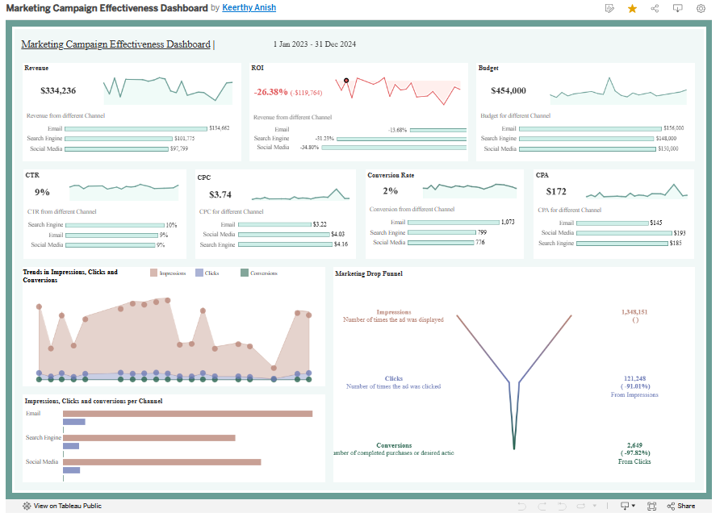

# Marketing Campaign Effectiveness Analysis

**Marketing analytics capstone | MySQL · Python (Pandas) · Tableau**  
**Analysis period shown in dashboard:** January 2023 – December 2024  
**Project type:** Educational capstone using a supplied practice dataset; not a real-world client engagement.

[**View the interactive dashboard on Tableau Public**](https://public.tableau.com/app/profile/keerthy.anish/viz/MarketingCampaignEffectivenessdashboard/MarketingCampaignEffectivenessDashboard)



### Project Background

This project was completed as part of my **Business Analytics Capstone Project at Eagan Academy, Dubai**, under the guidance of my mentor.

The project involved data cleaning, exploratory data analysis, database creation, and marketing campaign performance analysis using **MySQL, Python (Pandas), Excel, and Tableau**.

**Project Type:** Business Analytics Capstone Project  
**Institution:** Eagan Academy, Dubai
**Mentor:** Mr. Sreejith Surendran
**Dataset:** Synthetic training data

## 1. Business problem

A business is investing in multiple digital marketing campaigns across **Email, Search Engine, and Social Media**, but needs a consolidated view of how effectively this spending generates traffic, customer conversions, and revenue. Looking at impressions or clicks alone is not enough: management must be able to assess **return on investment (ROI), acquisition cost, conversion performance, and channel differences** before making budget decisions.

This case study answers: *Which channels generate the most value, where is marketing spend underperforming, and what should management investigate before reallocating budgets?*

## 2. Goals of the dashboard

- Monitor overall marketing performance through revenue, campaign budget, ROI, click-through rate (CTR), conversion rate, cost per click (CPC), and cost per acquisition (CPA).
- Compare **Email, Search Engine, and Social Media** to identify stronger and weaker channels.
- Examine impressions, clicks, and conversions through the marketing funnel and time-based trends.
- Support discussions about campaign optimization, spending efficiency, and future budget allocation.
- Give non-technical stakeholders a single interactive, executive-friendly view of marketing KPIs.

## 3. Dashboard KPI overview

The following figures were checked against the source Excel workbooks supplied for this portfolio review, with ROI and rates calculated from their totals.

| KPI | Result | Interpretation |
| --- | ---: | --- |
| Campaigns analyzed | **20** | Campaigns across three channels |
| Total campaign budget | **$454,000** | Budget allocated in the dataset |
| Total revenue | **$334,236** | Revenue attributed to recorded conversions |
| Revenue less budget | **−$119,764** | Shortfall relative to the reported campaign budget |
| Overall ROI | **−26.38%** | `(Revenue − Budget) / Budget × 100` |
| Impressions | **1,348,151** | Recorded ad displays |
| Clicks | **121,248** | Recorded ad clicks |
| Conversions | **2,649** | Recorded customer conversions |
| CTR | **8.99%** | Clicks ÷ impressions; shown as ~9% on the dashboard |
| Click-to-conversion rate | **2.18%** | Conversions ÷ clicks; shown as ~2% on the dashboard |

*Definitions:* ROI here compares attributed campaign revenue with the campaign budget provided. It is **not a complete measure of business profit** because costs beyond the campaign budget are not included. Totals are for the practice dataset, not verified company results.

## 4. Key dashboard visuals

| Visual | What it shows | Why it matters |
| --- | --- | --- |
| **Executive KPI cards** | Revenue, ROI, budget, CTR, CPC, conversion rate, and CPA, with compact trend lines | Provides a quick overview of commercial performance |
| **Channel comparison bars** | Email, Search Engine, and Social Media performance alongside key KPIs | Makes channel-level strengths and weaknesses visible |
| **Impressions, clicks & conversions trend** | Changes in funnel volumes across the reporting period | Helps identify fluctuations and periods worth investigating |
| **Marketing drop-off funnel** | Journey from ad impressions to clicks to customer conversions | Highlights how dramatically the audience narrows through the funnel |
| **Channel-level activity comparison** | Impressions, clicks, and conversions across the marketing channels | Helps compare engagement volume with downstream outcomes |
| **Interactive filters** | Analysis period and other supported dashboard interactions | Allows stakeholders to explore specific performance slices |

## 5. Business insights and key findings

### Channel performance

The channel names in the source campaign table included missing values and inconsistent spellings such as `E-mail`, `Emal`, `Search Engine.`, and `Social  Media`. For this comparison, those values were normalized into three categories; missing Email labels were identified from the associated campaign names.

| Channel | Budget | Revenue | ROI | Conversions |
| --- | ---: | ---: | ---: | ---: |
| **Email** | $156,000 | **$134,662** | **−13.68%** | **1,073** |
| **Search Engine** | $148,000 | $101,775 | −31.23% | 799 |
| **Social Media** | $150,000 | $97,799 | −34.80% | 777 |
| **Total** | **$454,000** | **$334,236** | **−26.38%** | **2,649** |

1. **None of the three channels delivered positive ROI** under the dataset's revenue-versus-budget definition; total attributed revenue fell short of the allocated marketing budget by **$119,764**.
2. **Email was the strongest channel**: it generated the most revenue ($134,662), the most conversions (1,073), and the least negative ROI (−13.68%). It is the best-performing channel *relative to the alternatives*, not a profitable one under this ROI definition.
3. **Social Media showed the weakest ROI** (−34.80%), followed by Search Engine (−31.23%). Both merit review of targeting, campaign mix, conversion quality, and spending.
4. The overall funnel recorded **1,348,151 impressions → 121,248 clicks → 2,649 conversions**. A strong headline impression or click count does not necessarily imply strong commercial returns.
5. Campaign and customer data required cleaning before comparison. Standardized channel categories and consistent keys are important for trustworthy KPI reporting.

### Exploratory data analysis (EDA)

The Python exploration also covered customer age, gender-category distributions, geography, campaign-level activity, conversion revenue distributions, boxplots/IQR-based outlier investigation, and correlation analysis. Supporting charts are in [the EDA presentation](analysis/EDA.pptx).

**Interpretation check:** An early EDA slide describes the revenue–budget relationship as strong, but its plotted Pearson coefficient is approximately **0.08**, indicating a **very weak linear correlation** in that analysis. The weak coefficient, not the original slide wording, is the appropriate interpretation. Correlation does not establish causation.

## 6. Potential business impact and recommendations

This is a **decision-support demonstration**, not a report of actual changes implemented by an employer. The analysis could help a marketing manager:

- **Prioritize an Email campaign review:** Investigate why Email outperforms the other channels and test whether effective tactics can be extended.
- **Review underperforming spending:** Examine Social Media and Search Engine campaigns at the campaign level before shifting budget; channel-wide ROI alone is not enough for a final allocation decision.
- **Reduce funnel drop-off:** Evaluate landing-page relevance, targeting, audience segments, and conversion journeys to improve the clicks-to-conversions rate.
- **Establish repeatable performance monitoring:** Track ROI, conversion rate, CPC, and CPA regularly, using standardized channel definitions and validated source data.

**No actual uplift or financial savings are claimed.** These are recommendations based on the simulated/training data.

## 7. Tools and work completed

| Tool | Work demonstrated |
| --- | --- |
| **MySQL Workbench** | Created the `marketing_Campaign_data` database and four table definitions (`customers`, `customer_conversions`, `campaigns`, `impression_clicks`); defined initial primary keys and inspected tables with `SELECT *`. |
| **Python / Pandas** | Imported Excel sheets, profiled data types and descriptive statistics, cleaned customer and campaign fields, standardized inconsistent channel values, identified duplicates/missing data, and exported processed data. |
| **NumPy / Matplotlib / Seaborn** | Conducted univariate and bivariate EDA, developed bar charts and histograms, explored IQR outliers and correlations, and visualized a correlation matrix. |
| **Tableau Public** | Built and published the interactive marketing KPI dashboard, channel comparisons, trends, and funnel visuals. |
| **PowerPoint** | Presented exploratory data analysis and supporting visual findings. |

**Scope of SQL work:** The original SQL script contains **database/table creation and basic SELECT queries only**. SQL JOINs, CTEs, window functions, and advanced SQL campaign-performance calculations are **not claimed as completed** in this repository.

## 8. Project files

```text
Marketing-Campaign-Effectiveness-Analysis/
├── README.md
├── requirements.txt
├── .gitignore
├── sql/
│   └── 01_original_schema.sql
├── python/
│   ├── 01_profile_data.py
│   ├── 02_clean_campaigns.py
│   └── legacy_scripts/
│       ├── EDA_Summary_Statistics_Info.py
│       ├── EDA_Univariate_Analysis.txt
│       ├── Outlier_detection_and_treatment.py
│       ├── Campaign_clean.py
│       └── Customer_clean.py
├── analysis/
│   └── EDA.pptx
├── dashboard/
│   ├── marketing_dashboard.png
│   └── README.md
└── data/
    └── README.md
```

- [`sql/01_original_schema.sql`](sql/01_original_schema.sql): original MySQL database-setup script.
- [`python/`](python/): a portable-oriented profiling/cleaning adaptation, plus the **original exploratory code** retained separately in `legacy_scripts`.
- [`analysis/EDA.pptx`](analysis/EDA.pptx): EDA charts and analysis presentation.
- [`dashboard/marketing_dashboard.png`](dashboard/marketing_dashboard.png): a static preview; the [Tableau Public link](https://public.tableau.com/app/profile/keerthy.anish/viz/MarketingCampaignEffectivenessdashboard/MarketingCampaignEffectivenessDashboard) provides interactive access.

### Data availability, reproducibility, and limitations

The original work used Excel campaign, customer, conversion, impression, and click datasets. **The source Excel files are intentionally excluded from this public-upload package** because the customer workbook contains names and location fields, and the right to republish those records has not been established. See [`data/README.md`](data/README.md).

The original scripts reflect an earlier local folder structure and workbook/sheet names, including local Windows paths; they are retained as **historical evidence of the work**, not a tested, one-command reproduction. The refactored example scripts have been syntax-checked, but **not fully re-run and validated against the supplied current workbooks**. Do not claim reproducibility until file names, sheet names, and outputs have been reconciled and the workflow has been tested end-to-end.

One exploratory customer-cleaning script includes **guessing gender from first names**. This is unreliable and should not be treated as validated demographic information or used for consequential decisions.

## 9. Possible next improvements

- Reconcile the current source workbooks with the Python pipeline, and publish a reproducible version using shareable anonymized or synthetic data.
- Improve the SQL schema: use appropriate numeric types for revenue/budget and properly support repeated daily impression/click records.
- Add and test MySQL joins and aggregate queries for campaign-level and channel-level KPIs.
- Add formal data-quality checks and reconcile KPI definitions (including rounding) between the source data and Tableau cards.

---

**Author:** Keerthy Anish  
**Interactive dashboard:** [Tableau Public — Marketing Campaign Effectiveness Dashboard](https://public.tableau.com/app/profile/keerthy.anish/viz/MarketingCampaignEffectivenessdashboard/MarketingCampaignEffectivenessDashboard)
